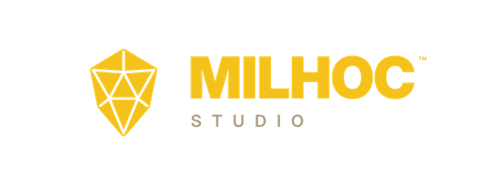
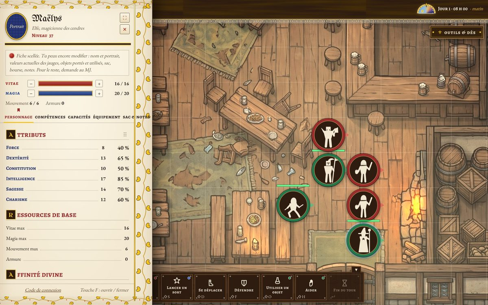
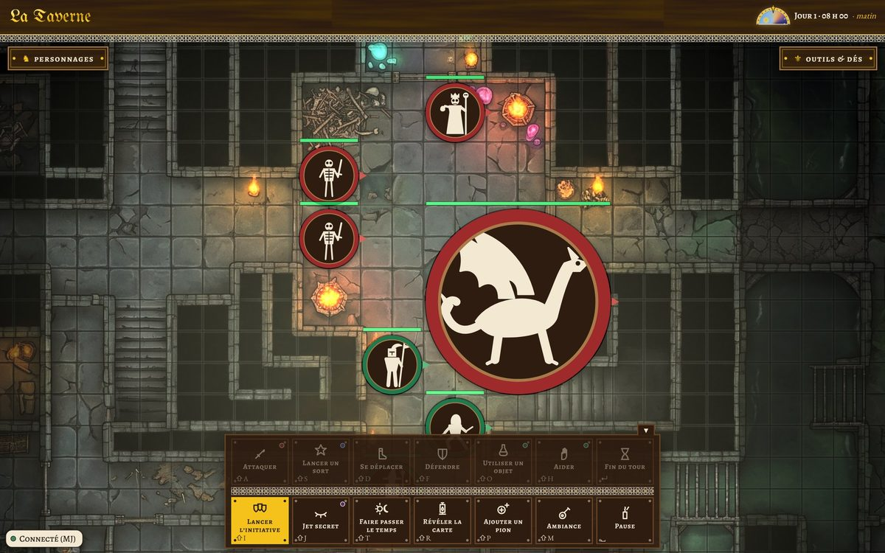
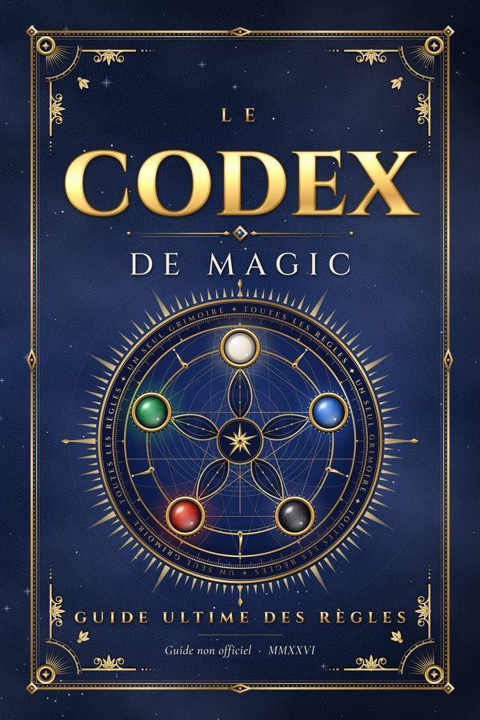

<h1 align="center">Dorian Millet</h1>

<b>Développeur logiciel en reconversion · Toulouse</b> Ex-prothésiste dentaire (CFAO, conception 3D) · Je construis aujourd'hui les logiciels que j'utilisais hier.

  
  
  

## À propos

Pendant huit ans, j'ai conçu des prothèses dentaires en 3D au dixième de millimètre, avec des logiciels de CFAO. Autodidacte, je développe maintenant mes propres applications, du serveur temps réel à l'interface 3D.

Je recherche un **stage**, puis une **alternance de Concepteur Développeur d'Applications**, dans le secteur de Toulouse.

## Stack

## Projets

> Mes projets sont menés sous mon studio, **Milhoc studio**. Leur code est privé, mais mon activité sur ces dépôts apparaît dans mon calendrier de contributions. Démonstration possible en entretien.

### 🎲 La Taverne · table de jeu virtuelle (VTT) — v0.1.7
Application de jeu de rôle en ligne, menée du prototype à la version 0.1.7 : carte tactique (brouillard de guerre, murs, pions), dés 3D avec moteur physique, fiches de personnages liées aux données, règles configurables, parties multijoueurs en temps réel. Licences (Steam ou clé) pour le meneur de jeu, accès libre pour les joueurs invités. Plus de 2 400 vérifications automatisées.

  
  
  

`Python` `Flask` `Socket.IO` `JavaScript` `Three.js` · 🔒 code privé

### 🎙️ Rick · assistant vocal pour Windows
Assistant vocal qui fonctionne avec l'IA de son choix, en local et gratuit par défaut (Ollama) ou dans le cloud (Claude, Mistral, OpenAI, Gemini…). Un routeur choisit automatiquement l'IA et le modèle selon la demande, avec relais si l'une ne répond pas. Il peut agir dans les sites web via un navigateur piloté. Livré avec un installeur Windows et une suite de tests.

`Python` `faster-whisper` `edge-tts` `PyInstaller` `Inno Setup` · 🔒 code privé

### 🌐 Claude Browser Control · serveur MCP multi-navigateurs
Serveur MCP qui permet à Claude de piloter n'importe quel navigateur (Chrome, Edge, Firefox, WebKit, Brave, Opera, Arc…), de se brancher sur un navigateur déjà ouvert, et de comparer une page sur plusieurs moteurs. Refus automatique des bandeaux de cookies. Construit sur Playwright MCP.

`Node.js` `Playwright` `MCP` · 🔒 code privé

### 🧩 Skills pour Claude
Méthodes réutilisables pour Claude : conception d'agents IA en 9 étapes, optimisation de vidéos (YouTube, Shorts, TikTok, Reels), pilotage de navigateur, organisation d'espace de travail.

`Markdown` `Claude` · 🔒 code privé

### 🏰 Milhoc studio · site et communauté
Site vitrine multilingue (français, anglais, espagnol) avec formulaire d'inscription, et scripts Python qui montent et animent le serveur Discord du studio.

`HTML` `CSS` `PHP` `Python` · 🔒 code privé

### 📖 Codex de Magic · livre imprimé

Guide des règles de Magic: The Gathering, mis en page en 16×24 pour l'impression : chaîne de fabrication automatisée (Markdown vers LaTeX, couverture générée par script).

`LaTeX` `Lua` `Python` · 🔒 code privé

### 🦷 labo-suivi · suivi d'un laboratoire de prothèse dentaire
Application web de suivi des travaux d'un laboratoire, née de mon ancien métier.

`Python` `Flask` `SQLite` `pytest` · 🔒 code privé

### ⚔️ Scripting pour serveurs multijoueurs
Systèmes d'inventaire, mécaniques de jeu et gestion de boutiques.

`Lua`

## Contact

[LinkedIn : linkedin.com/in/dorian-millet](https://www.linkedin.com/in/dorian-millet) · ouvert aux échanges sur le métier, les stages et l'alternance.
