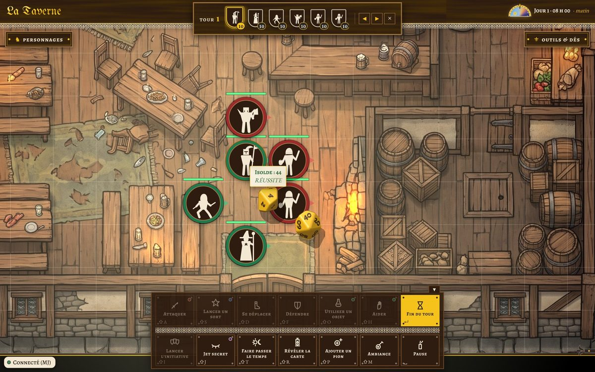
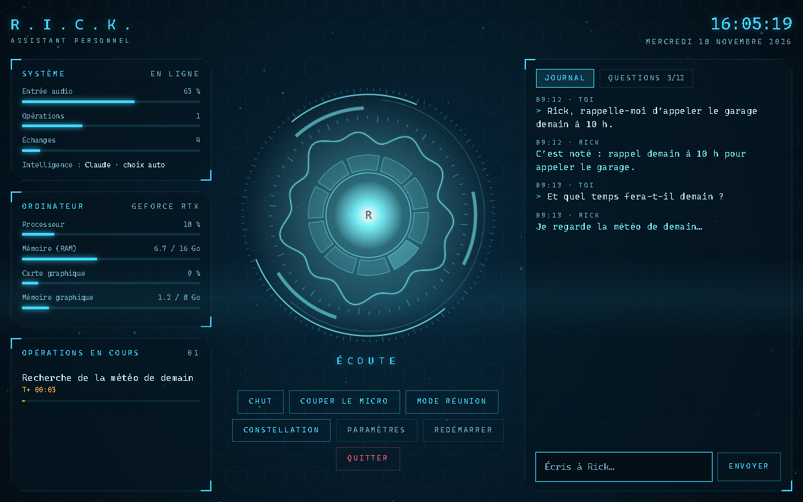
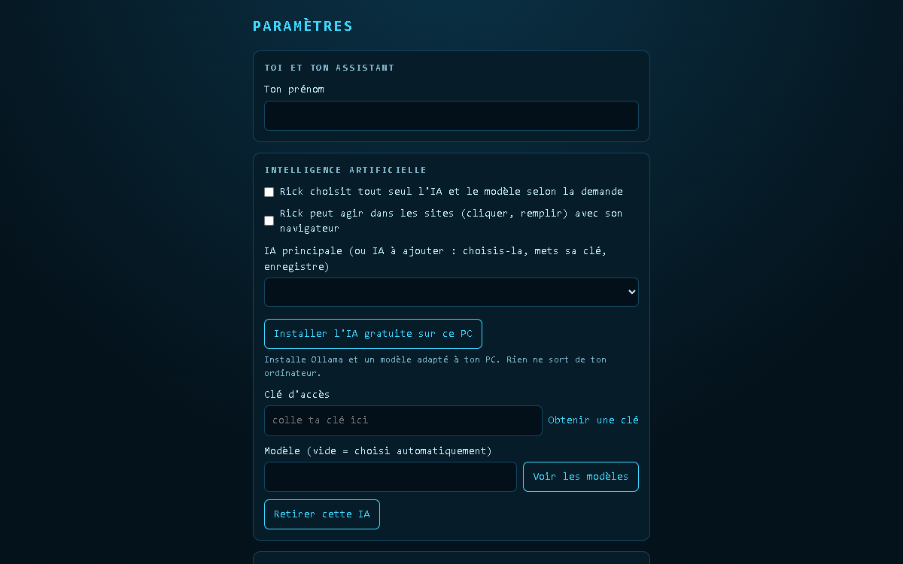

<h1 align="center">Dorian Millet</h1>

<b>Développeur d'applications · Fondateur de <a href="https://milhocstudio.fr">Milhoc Studio</a> · Toulouse</b> Ex-prothésiste dentaire (CFAO, conception 3D) · Je construis aujourd'hui les logiciels que j'utilisais hier.

  
  
  
  

## À propos

Pendant huit ans, j'ai conçu des prothèses dentaires en 3D au dixième de millimètre, avec des logiciels de CFAO. Autodidacte, je développe maintenant mes propres applications au sein de **Milhoc Studio**, mon studio : une table de jeu de rôle en ligne, un assistant vocal pour Windows, un serveur MCP de pilotage de navigateurs et un outil de suivi pour les laboratoires de prothèse.

Je cherche une **alternance de développeur** à Toulouse : Concepteur Développeur d'Applications (RNCP 6) ou Développeur informatique, spécialisation Builder IA, chez OpenClassrooms (RNCP 5).

## 🔒 Projets (code privé)

> Mes projets sont menés sous mon studio, **[Milhoc Studio](https://milhocstudio.fr)**. Leur code est privé, mais mon activité sur ces dépôts apparaît dans mon calendrier de contributions. Démonstration possible en entretien.

### 🎲 La Taverne · table de jeu de rôle virtuelle (v0.1.7)
Le produit phare du studio, mené du prototype à la version 0.1.7 : carte tactique (brouillard de guerre, murs, pions), dés 3D avec moteur physique, fiches de personnages liées aux données, règles configurables, parties multijoueurs en temps réel. Licences (Steam ou clé) pour le meneur de jeu, accès libre pour les joueurs invités. Plus de 2 400 vérifications automatisées.

  
  
  

`Python` `Flask` `Socket.IO` `JavaScript` `Three.js`

### 🎙️ Rick · assistant vocal pour Windows
Marche avec l'IA de son choix, gratuit et local par défaut (Ollama) ou dans le cloud (Claude, Mistral, OpenAI, Gemini…). Un routeur choisit la bonne IA à chaque demande et bascule sur la suivante si l'une est indisponible. Reconnaissance vocale locale (Whisper), navigateur piloté avec accord avant chaque nouveau site, clés rangées dans le coffre de Windows, mises à jour signées, installeur et tests automatisés.

  
  

`Python` `faster-whisper` `Ollama` `MCP` `PyInstaller` `Inno Setup`

### 🧭 Claude Browser Control · serveur MCP multi-navigateurs
Donne à Claude le contrôle de n'importe quel navigateur (Chrome, Edge, Firefox, WebKit, Brave, Opera, Arc…), change de navigateur à chaud, se branche sur un navigateur déjà ouvert et compare une page sur plusieurs moteurs. Refus automatique des bandeaux de cookies. Construit sur Playwright MCP.

`Node.js` `MCP` `Playwright`

### 🦷 Labo Suivi · suivi des travaux d'un laboratoire de prothèse
L'outil qui me manquait quand j'étais prothésiste : chaque travail, son cabinet, sa teinte, son échéance et son étape, avec les retards en rouge. Testé avec pytest.

`Python` `Flask` `SQLite` `pytest`

### 🎬 Vidboost · un skill Claude pour obtenir plus de vues
Titres, miniature, accroche, structure de rétention, hashtags et meilleur créneau de publication pour YouTube, Shorts, TikTok et Reels. Pas de fausses vues : uniquement ce qui fait cliquer et rester.

`Claude Skill` `Prompt engineering`

### 🏰 Site et communauté du studio
[milhocstudio.fr](https://milhocstudio.fr) : site vitrine multilingue (français, anglais, espagnol) avec formulaire d'inscription, et scripts Python qui montent et animent le serveur Discord du studio.

`HTML` `CSS` `PHP` `Python`

### 📖 Codex de Magic · livre imprimé

Guide des règles de Magic: The Gathering, mis en page en 16×24 pour l'impression : chaîne de fabrication automatisée (Markdown vers LaTeX, couverture générée par script).

`LaTeX` `Lua` `Python`

### ⚔️ Scripting pour serveurs multijoueurs
Inventaires, mécaniques de jeu et boutiques.

`Lua`

## Stack

## Contact

[LinkedIn : linkedin.com/in/dorian-millet](https://www.linkedin.com/in/dorian-millet) · [milhocstudio.fr](https://milhocstudio.fr) · ouvert aux échanges sur le métier et l'alternance.
